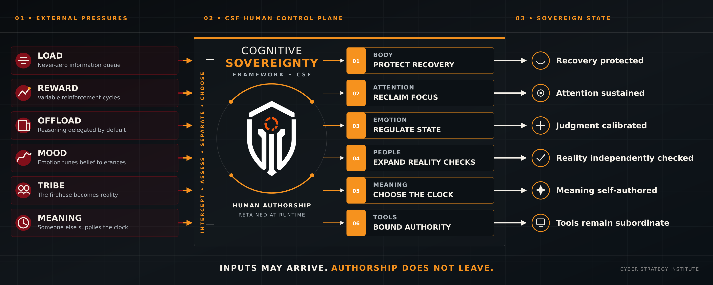

# Cognitive Sovereignty Framework v3.0

<!-- csf-root-status:start -->
[](https://github.com/CyberStrategyInstitute/cognitive-sovereignty/releases/tag/Cognitive_Sovereignty_Framework-v3.0)
[](LICENSE)
[](LICENSE)
[](FRAMEWORK.md)
[](resources/mitigation-catalog.md)
[](taxonomy/README.md)
[](schemas/README.md)
[](06-digital-ai-symbiosis/federal-procurement-alignment.md)
[](research/intake/README.md)
[](https://github.com/CyberStrategyInstitute/cognitive-sovereignty/actions/workflows/evidence-check.yml)

Framework 3.0.0 is published. Scope: six domains and five causal layers; 56 documented controls and 54 taxonomy entries. Code and machine-readable data: MIT. Documentation: CC BY-SA 4.0. UAS mapping is a documented crosswalk, not certification. Event CTSS values remain provisional CSI judgments. The workflow badge reports CI status, not control efficacy.

[Complete page map (HTML)](https://cyberstrategyinstitute.github.io/cognitive-sovereignty/page-map.html) · [Markdown page map](PAGE_MAP.md) · [Change legend and baseline](REPOSITORY_REVIEW.md#change-labels) · [Published release](https://github.com/CyberStrategyInstitute/cognitive-sovereignty/releases/tag/Cognitive_Sovereignty_Framework-v3.0)
<!-- csf-root-status:end -->

CSF helps people and organizations examine whether they retain the ability to understand, choose, challenge, and govern AI-mediated decisions. Cyber Strategy Institute maintains the model, taxonomy, research, and CTSS assessments.

The core remains **six domains, five causal layers, and the existing CTSS formula**. CSF v3.0.0 connects the research intake to domain controls, assessments, tracked actions, and reusable data. The major version identifies the expanded research-to-control workflow and revised readiness criteria.

[What changed in v3.0](#what-changed-in-v30) · [Start here](#start-with-your-task) · [Six domains](#the-six-domains) · [Research](#research-and-actions) · [Web tools](#read-it-in-a-browser) · [Contribute](#build-check-and-contribute) · [Star History](#star-history)

<!-- csf-release-highlights:start -->
## What changed in v3.0

CSF 3.0 connects a news item to a score, a proposed action, a domain control, and a readiness check. You can trace why a judgment was made, repeat the assessment, and compare later results using the same method.

**Comparison:** published 3.0 versus the recorded [pre-3.0 baseline](REPOSITORY_REVIEW.md#change-labels). These capabilities were already published in 3.0; this README update makes them easier to find.

| Change | What changed | What you can do now |
|---|---|---|
|  | [Research intake and CTSS records](research/intake/README.md) preserve individual items, sources, input reasons, and revisions. | Review each assessment and compare the declared weekly sample over time. |
|  | 12 research-linked controls added across all six domains. | Follow the [control catalog](resources/mitigation-catalog.md) to its research rationale, owner role, test, and failure response. |
|  | 20 inherited controls refined; prior wording remains in the records. | See what changed and why before updating your local implementation. |
|  | [Signal tracking](research/intake/signals/README.md) links source excerpts to dispositions, proposed responsible roles, and review triggers. | Track watch items and research needs without counting every excerpt as a separate incident. |
|  | [Readiness criteria](resources/readiness-worksheet.md) separate inherited capabilities from research extensions. | Use the [worked unit assessment](examples/unit_readiness_assessment.md) and keep missing evidence unknown. Start a new comparison when criteria change. |
|  | [Baseline and perspective documentation](lenses/founding-baseline-assessment.md), [schemas and agent/MCP access](integration/README.md), and linked web views. | Declare the lens behind a judgment and reuse structured records. Lens profiles remain draft templates. |
|  | Six domains, five causal layers, CTSS weights, and stable inherited control IDs. 24 controls retain their inherited implementation. | Keep the core model and trace earlier records. 20 other inherited IDs have updated guidance. |

### Changes across the six domains

NEW means an added control. UPDATED means a refined inherited control. RETAINED means inherited guidance. None of these labels means a new domain or taxonomy class. No controls are DEPRECATED in this comparison.

| Domain | NEW controls | UPDATED controls | RETAINED controls |
|---|---:|---:|---:|
| [Biological](01-biological/README.md) | 2 | 2 | 4 |
| [Cognitive](02-cognitive/README.md) | 2 | 5 | 3 |
| [Emotional](03-emotional/README.md) | 2 | 3 | 3 |
| [Social](04-social/README.md) | 2 | 2 | 5 |
| [Purpose & Moral](05-purpose-moral/README.md) | 2 | 3 | 5 |
| [Digital & AI Symbiosis](06-digital-ai-symbiosis/README.md) | 2 | 5 | 4 |

**Evidence limits:** more documented controls do not establish better observed readiness. Event CTSS scores remain provisional CSI judgments. See [research note 010](research/010_domain_controls_and_readiness.md) for control rationale and comparison limits.

[Full change log](CHANGELOG.md) · [Release notes](https://cyberstrategyinstitute.github.io/cognitive-sovereignty/CSF-3.0.0-release-notes.html) · [Remaining roadmap work](EVOLUTION.md)
<!-- csf-release-highlights:end -->

## Start with your task

| I want to... | Go here |
|---|---|
| Understand the model | [Framework reference](FRAMEWORK.md) and [six domains](#the-six-domains) |
| Read the research and individual scores | [Research hub](https://cyberstrategyinstitute.github.io/cognitive-sovereignty/research.html) or [complete report](research/intake/reports/research-assessment.md) |
| Inspect the weekly baseline | [Seven weekly reports and trends](research/intake/reports/baseline.md), [CSV](research/intake/event-scores.csv), [JSON](research/intake/events.json) |
| Apply controls and assess readiness | [Control catalog](resources/mitigation-catalog.md), [resources workflow](resources/README.md), [worked unit example](examples/unit_readiness_assessment.md) |
| Check the roadmap | [Evidence and remaining milestones](EVOLUTION.md) |
| Find the next action | [Watch/action register](research/intake/signals/README.md) |
| Assess a new item | [Intake method](research/intake/README.md), [scorecard template](resources/scorecard-template.md), [decision record](resources/decision-record.md) |
| Use another declared perspective | [Baseline and lens assessment](lenses/founding-baseline-assessment.md) |
| Use CSF from an agent or MCP server | [Integration guide](integration/README.md), [catalog](docs/data/catalog.json), [schemas](schemas/README.md) |
| See what changed and remains open | [Recommendation coverage](RECOMMENDATIONS.md), [change log](CHANGELOG.md) |

CSF 3.0 is [published](https://github.com/CyberStrategyInstitute/cognitive-sovereignty/releases/tag/Cognitive_Sovereignty_Framework-v3.0), and the documentation site is built from `main/docs`. Research and readiness limitations remain stated with each record. The banner illustrates the intended architecture; deployment and effectiveness require implementation evidence.

## The six domains

| Domain | What it covers |
|---|---|
| [Biological](01-biological/README.md) | Sleep, metabolism, nervous-system regulation, and physiological integrity |
| [Cognitive](02-cognitive/README.md) | Attention, reasoning, memory, learning, and independent judgment |
| [Emotional](03-emotional/README.md) | Regulation, stress tolerance, identity stability, and recovery |
| [Social](04-social/README.md) | Trust networks, relationships, belonging, and community coordination |
| [Purpose and Moral](05-purpose-moral/README.md) | Values, meaning, responsibility, and moral reasoning |
| [Digital and AI Symbiosis](06-digital-ai-symbiosis/README.md) | Working with AI while retaining capability, authority, and resistance to manipulation |

The causal layers remain civilizational drivers, substrate threats, manipulation techniques, delivery/scale, and human outcomes. See the [taxonomy architecture](taxonomy/threat-architecture.md), [registry](taxonomy/registry.json), and [generated technique rankings](taxonomy/ctss-rankings.md).

## What a CTSS score means

CTSS is our assessed severity for a declared threat scenario or event-linked risk. It combines likelihood, agency impact, reach, detection difficulty, and recovery difficulty. Each estimate needs a reason and evidence or a declared assumption. A provisional score is a usable judgment with explicit uncertainty.

The existing formula can be written as whole points: `L*5 + Ia*6 + R*4 + D*3 + RecD*2`. It still produces 0-100. See [the method](taxonomy/ctss-scoring.md) and [the arithmetic correction](research/scoring-correction-2026-11-07.md).

Keep taxonomy reference estimates, item assessments, directly measured outcomes, and illustrative lens results separate. Helpful and contrary evidence belong in the record. An aggregate describes its declared sample; it is not a percentage of Americans harmed or protected.

## Research and actions

The supplied September-November collection is preserved as **87 assessed item records**, **92 appearances**, **86 source-linked story threads**, and **217 tracked source excerpts**. Those excerpts include grouping labels, proposed actions, research questions, indicators, and watch items. They are not 217 independent incidents. The historical scores were backfilled November 7, 2026.

Every item retains original analysis, sources, input reasons, action, and research trigger. Every tracked signal has an ID, status, proposed responsible role, review trigger, and history. Documented guidance is distinguished from field validation. See [the full ledger](research/intake/events.json) and [signal register](research/intake/signals/register.json).

The [six safeguards](resources/practical-safeguards.md), [additional research checks](resources/advanced-checks.md), and [pilot plan](monitoring/pilot-plan.md) turn findings into reviewable work. Claims of population protection or architectural guarantees require the relevant implementation and test evidence.

## Repository structure

```text
01-biological/ ... 06-digital-ai-symbiosis/  Domain doctrine, threats, controls, readiness
research/             Notes, original intake, scores, and weekly reports
resources/            Assessment workflow, mitigation catalog, and worksheets
examples/             Reproducible fictional assessments
monitoring/           Observed results, protocols, and roadmap status
docs/                 Learning Hub, Explorer, Command Center, and practice pages
integration/          Agent and optional MCP access
tools/ and tests/     Shared calculations, builds, and verification
```

The control catalog now has 56 entries: 44 inherited IDs, including 20 refinements, plus 12 additions. [Research note 010](research/010_domain_controls_and_readiness.md) explains each domain’s changes and the separate readiness profiles. More documented controls do not establish measured readiness.

## Read it in a browser

- [Complete page map](https://cyberstrategyinstitute.github.io/cognitive-sovereignty/page-map.html)
- [Learning hub](https://cyberstrategyinstitute.github.io/cognitive-sovereignty/)
- [Research, scores, and signals](https://cyberstrategyinstitute.github.io/cognitive-sovereignty/research.html)
- [Controls, resources, and readiness](https://cyberstrategyinstitute.github.io/cognitive-sovereignty/practice.html)
- [Threat explorer](https://cyberstrategyinstitute.github.io/cognitive-sovereignty/csf-explorer.html)
- [Command center](https://cyberstrategyinstitute.github.io/cognitive-sovereignty/csf-command-center.html)
- [How to use and build it](https://cyberstrategyinstitute.github.io/cognitive-sovereignty/guide.html)

For a local preview, run `python -m http.server 8000 --directory docs` from the checkout and open `http://localhost:8000/research.html`.

## Build, check, and contribute

Python 3.12 and Node 22 are the CI baseline. Local checks also passed with Node 24. `VERSION` is the single framework-version source. `python -m tools.version` checks all website entrypoints, citation, taxonomy, and data catalog. Core Python tools use the standard library. The MCP adapter is optional and has its own dependency file.

```text
python -m tools.build
python tools/csf.py check
python -m tools.event_monitor check
python -m tools.signals check
python -m tools.export check
python -m tools.version
python -m tools.presentation check
python -m tools.check_repo
python -m unittest discover -s tests
node tests/check_dashboards.cjs
```

Read [CONTRIBUTING.md](CONTRIBUTING.md), [AGENTS.md](AGENTS.md), and [SECURITY.md](SECURITY.md). Changes belong in a PR for owner review. CODEOWNERS and automated checks support review; they do not replace branch-protection settings or authorize a merge.

[AI SAFE²](https://github.com/CyberStrategyInstitute/ai-safe2-framework) is the companion machine-side governance framework. The [UAS crosswalk](06-digital-ai-symbiosis/federal-procurement-alignment.md) explains the profile relationship and its limits.

## License and citation

The existing [dual license](LICENSE) remains: MIT for the covered code/machine-readable components and CC BY-SA 4.0 for framework documentation. Retain attribution and source rights. [CITATION.cff](CITATION.cff) provides citation metadata. Use a pinned commit when reproducibility matters.

## Star History

<a href="https://www.star-history.com/?repos=CyberStrategyInstitute%2Fcognitive-sovereignty&type=Date">
  <picture>
    <source media="(prefers-color-scheme: dark)" srcset="https://api.star-history.com/svg?repos=CyberStrategyInstitute/cognitive-sovereignty&amp;type=Date&amp;theme=dark">
    <source media="(prefers-color-scheme: light)" srcset="https://api.star-history.com/svg?repos=CyberStrategyInstitute/cognitive-sovereignty&amp;type=Date">
    
  </picture>
</a>

[Open the interactive chart](https://www.star-history.com/?repos=CyberStrategyInstitute%2Fcognitive-sovereignty&type=Date) · [Framework reference and theme-aware integration](FRAMEWORK.md#star-history)

The chart loads from Star History. If the service is unavailable, use the interactive link. Stars show repository interest, not framework effectiveness.

<!-- csf-return-navigation:start -->
[Repository home](README.md) · [Complete page map](PAGE_MAP.md) · [Resources](resources/README.md) · [Research](research/README.md) · [Data catalog](docs/data/catalog.json)
<!-- csf-return-navigation:end -->
