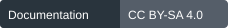

<!-- csf-module-header:start -->


CSF 3.0.0. Documentation: NEW in 3.0. Repository documentation; implementation limits remain explicit.

[](../VERSION) [](../LICENSE)
<!-- csf-module-header:end -->

# Measure, compare, explain

CSF monitoring should answer three questions: What did we check? What changed? What should we do?

The main baseline is the [complete weekly intake](../research/intake/reports/baseline.md), with 87 item-level provisional scores and original analysis from the supplied editions. Use [the event ledger method](../research/intake/README.md) and [weekly research instruction](weekly-intake-prompt.md) for ongoing work. The six broad scenarios below are a separate exercise, not a substitute for item-level research or historical trends.

## What works now

The offline tool checks registry arithmetic, generated files, research records, and measurement records. It produces a draft report. It makes no network calls and incurs no model charges. Repository checks run automatically on pull requests and main-branch updates through the merged GitHub workflow. The existing CSI weekly briefs automation was updated November 7 with the complete CSF intake and scoring requirements; its schedule and other topic instructions were preserved. No new scheduled run or live human/model evaluation was performed in this task.

```
python tools/csf.py check
python -m unittest discover -s tests
python tools/csf.py report --output monitoring/latest.md
```

Each saved report has a JSON companion containing input hashes, code hash, commit, and whether local changes were present. Keep dated reports to preserve history. To compare evidence records, use `python tools/csf.py report --baseline monitoring/runs/2026-11-07-initial.json --output monitoring/runs/next-review.md`. This flags added or changed research records and reference scores. A record change is not automatically a changed threat. Use a new output path so the baseline remains intact.

## Keep four kinds of result separate

| Result | What we count | What it can establish |
|---|---|---|
| Repository checks | Correct reference totals, missing fields, stale files | Whether the documented data is internally consistent |
| Research intake | Reviewed records and distinct source lineages | What reviewed sources report, with their limits |
| CSF assessments | Individual CTSS scores, revisions, and aggregate trends | CSI’s source-backed assessment of threats from a U.S. perspective |
| Direct observations | Passed cases out of attempted cases | How a named system or workflow performed on those cases |

CSF is the source of record for its own assessments. We analyze research and real-world developments, assign our CTSS inputs, explain them, and publish individual and aggregate scores over time. Direct human experiments are useful but are not a prerequisite for issuing an assessment. Repeated coverage of one incident still represents one underlying event. Label inferred impact and scope assumptions so readers can challenge the method and reproduce the arithmetic.

## Our threat assessment series

`assessments.json` contains dated U.S.-focused scenarios. Each record states sources, affected taxonomy IDs, all five input estimates, reasons, confidence, action, and limits. The reporting tool calculates CTSS, ranks scenarios, and reports the sample mean and priority distribution. It compares revisions of the same scenario separately from new intake. Preserve old rows; add a dated revision when evidence changes the judgment.

The first edition scores six research-informed scenarios. It is a selected analytical sample, not an inventory of U.S. incidents. Likelihood is scored at 1 because the reviewed sources document research mechanisms without establishing regular operational deployment in these U.S. settings. Reach is scenario potential, and impact/recovery include declared analyst estimates. These decisions keep the score contestable without withholding it.

Publish assessments with their reasoning. Evaluate the method against later incidents, replications, corrections, control failures, and outcomes. A revised score can reflect a changed threat, new evidence, or a corrected judgment; state which. The mean describes the selected scenarios, not the percentage of Americans harmed. A changed sample can move the mean even when no existing score changes.

## A simple rule for directly measured changes

Save an initial baseline. Repeat the same protocol and case set under the same task condition, population, and environment. Record the system/model version even when a version change is what we are studying. The report compares each later observation with that first baseline. A changed protocol or case set starts a new comparison group. Do not silently replace the baseline.

Show the count first: for example, a synthetic illustration of 8 correct decisions out of 10 followed by 6 out of 10. That is a drop of 20 percentage points. Flag a drop of 10 points or more for review. This starting trigger is a workflow choice, not a validated threshold or a statistical test. Small samples can vary by chance. Review the individual cases and evidence before calling the change drift or explaining its cause.

One observation means baseline only. Missing data means unknown. Only `observed` records enter real-result comparisons. Synthetic records are counted separately and excluded. A passed case must always mean a better outcome; record harmful-event avoidance as a pass, rather than reversing a metric's direction without changing the protocol.

## Record a measurement

`measurements.json` starts empty. Add one aggregate per day per comparable metric. Each record needs:

- Unique ID and ISO date.
- Workflow, metric, protocol version, case set, condition, population, and environment.
- System/model version and assessor.
- Kind: `observed` or `synthetic`.
- Passed count, total attempted count, and a traceable evidence location.

Use [the synthetic example](example-measurements.json) to learn the format. Running a report on it must not produce a real-world result. Record skipped or inaccessible tests in the decision record; do not count them as passes. Do not store participant identities or private conversations here.

## Proposed weekly operation

1. Review selected primary sources, U.S.-relevant incidents, and the weekly brief. Record original evidence and contrary findings. Produce a dated CSF assessment with source-backed reasons for each input.
2. Calculate individual CTSS scores and compare prior assessments. Aggregate the assessed sample and show new intake separately. Where direct tests are available, record them as an additional evidence stream.
3. The reporting tool validates counts, compares compatible observations, and prepares a draft. A failed collection or missing evidence is a coverage gap.
4. A human checks unexpected changes, factual wording, privacy, and denominators. Publish only the approved result and its limits.

Start publishing the assessment series after owner review; a pilot is not a prerequisite. Use [one pilot](pilot-plan.md) to test a chosen safeguard alongside that series. Decide whether a weekly scheduled collection job is useful once the intake scope and sources are set. The manual GitHub workflow already prepares a report artifact; a schedule can be added after the collection source, owner, and test budget are agreed. No automatic posting is proposed.

## A publishable statement

For an assessment, use: CSF assesses [scenario] at CTSS [score] as of [date], from a U.S. perspective. The main drivers are [inputs and reasons]. Evidence supports [finding]; we infer [assumption]. Our prior score was [score/date]. We changed it because [reason].

For a direct test, use this pattern after review: On [date], [system/version] passed [x] of [n] cases on [protocol/case set]. The comparable baseline was [b] of [m] on [date]. The main failures were [categories]. Results apply to [scope]. [Limitations].

A monitoring result is a scoped finding. It does not establish that CSF prevents manipulation across a population. Reports remain drafts until an authorized owner clears publication.

## Domain capability results

Use [the readiness worksheet](../resources/readiness-worksheet.md), [catalog](../resources/mitigation-catalog.md), and [worked unit example](../examples/unit_readiness_assessment.md). `readiness-assessments.json` starts empty. The read-only summary excludes synthetic examples and keeps inherited capability profiles separate from the two new checks per domain. No observed unit readiness increase is claimed. `python -m tools.readiness` reports the current observed collection.

<!-- csf-section-files:start -->
## Section files

- [assessments.json](assessments.json)
- [automation-update-2026-11-07.json](automation-update-2026-11-07.json)
- [example-measurements.json](example-measurements.json)
- [latest.json](latest.json)
- [latest.md](latest.md)
- [measurements.json](measurements.json)
- [pilot-plan.md](pilot-plan.md)
- [readiness-assessments.json](readiness-assessments.json)
- [roadmap.json](roadmap.json)
- [runs/](runs/)
- [weekly-intake-prompt.md](weekly-intake-prompt.md)
<!-- csf-section-files:end -->

<!-- csf-return-navigation:start -->
[Repository home](../README.md) · [Complete page map](../PAGE_MAP.md) · [Resources](../resources/README.md) · [Research](../research/README.md) · [Data catalog](../docs/data/catalog.json)
<!-- csf-return-navigation:end -->
